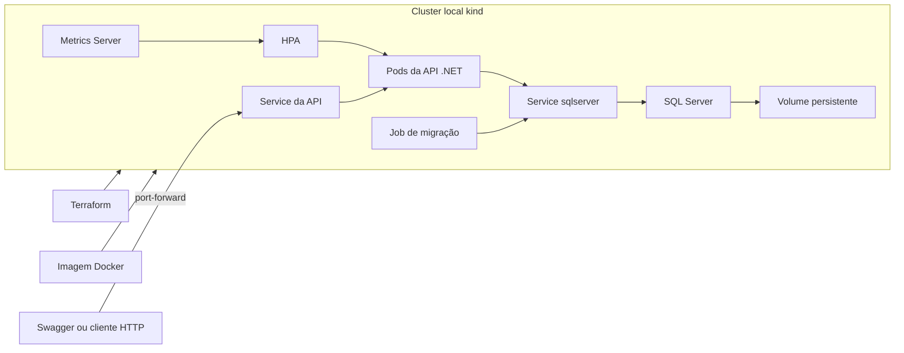

# Kubernetes da oficina

Execute os comandos na raiz do repositório, no PowerShell 7. Use Docker Desktop em modo de contêineres Linux em uma máquina x64, com o Docker em execução e pelo menos 4 GiB disponíveis para o ambiente. Instale [kind](https://kind.sigs.k8s.io/docs/user/quick-start/), [kubectl](https://kubernetes.io/docs/tasks/tools/install-kubectl-windows/) e [Terraform](https://developer.hashicorp.com/terraform/install). O pipeline usa kind 0.29.0 com Kubernetes 1.33. O Metrics Server escolhido exige Kubernetes 1.31 ou superior.



## 1. Criar o cluster e carregar a imagem

Um **cluster** é o conjunto de máquinas onde o Kubernetes executa as aplicações. Cada máquina é um **nó**. O **kind** usa um contêiner Docker como nó, e o **Terraform** registra e executa a criação desse cluster e dos recursos do banco.

```powershell
terraform -chdir=infra init
terraform -chdir=infra validate
terraform -chdir=infra apply
kubectl --context kind-oficina get nodes

docker build -t oficina-api:local .
kind load docker-image oficina-api:local --name oficina
```

Confira se o nó aparece como `Ready` e se os comandos da imagem terminam com sucesso. O Terraform já aplica o ConfigMap e os manifestos do banco. O banco fica à espera do Secret.

## 2. Configurar e testar o SQL Server

Um **ConfigMap** fornece configurações comuns, como a porta da API. Um **Secret** fornece valores sensíveis. O script cria os Secrets com as variáveis do terminal, e os YAML comentados mostram onde cada valor é usado.

Um **Pod** é a unidade que o Kubernetes executa. Um **Deployment** mantém os Pods em execução e cria substitutos quando necessário. Um **Service** dá um endereço estável aos Pods, como `sqlserver:1433`, mesmo quando o IP de um Pod muda.

Um **PersistentVolumeClaim** (PVC) solicita espaço em disco para o banco. Ele permite que um Pod substituto monte o mesmo volume. O volume local do kind pertence ao cluster criado nesta etapa.

Defina as credenciais do ambiente de demonstração. Guarde a senha do SQL com o volume, pois o banco existente continua usando a senha configurada na primeira inicialização.

```powershell
$env:MSSQL_SA_PASSWORD = Read-Host 'Senha nova do SQL Server' -MaskInput
$env:JWT_SIGNING_KEY = [Convert]::ToBase64String([Security.Cryptography.RandomNumberGenerator]::GetBytes(32))
$env:BOOTSTRAP_ADMIN_EMAIL = Read-Host 'E-mail do administrador inicial'
$env:BOOTSTRAP_ADMIN_PASSWORD = Read-Host 'Senha do administrador inicial' -MaskInput
./k8s/Criar-Secrets.ps1

kubectl --context kind-oficina get configmap oficina-config
kubectl --context kind-oficina get secret sqlserver-secret oficina-api-secret
kubectl --context kind-oficina rollout status deployment/sqlserver --timeout=300s
kubectl --context kind-oficina get pvc sqlserver-dados
```

Use senhas fortes com maiúsculas, minúsculas, números e caracteres especiais. O volume deve aparecer como `Bound`. O rollout termina quando a **sonda de prontidão**, uma verificação periódica dentro do Pod, consegue executar uma consulta ao SQL Server. Em caso de falha, use `kubectl --context kind-oficina get pods` e `kubectl --context kind-oficina logs deployment/sqlserver`.

Ao retomar o laboratório, reutilize os Secrets existentes. Gere uma nova chave JWT apenas quando quiser invalidar os tokens anteriores. Se mudar a configuração passada por variáveis de ambiente ou carregar uma versão nova da imagem com a mesma tag, reinicie os Pods da API com `kubectl --context kind-oficina rollout restart deployment/oficina-api` após preparar o banco.

## 3. Preparar o banco

Um **Job** executa uma tarefa até ela terminar. Este Job roda as migrações do Entity Framework e cria os papéis e o administrador inicial antes de publicar a API.

```powershell
kubectl --context kind-oficina apply -f k8s/03-migracao.yaml
kubectl --context kind-oficina wait --for=condition=complete job/oficina-migracao --timeout=300s
kubectl --context kind-oficina logs job/oficina-migracao
```

O resultado esperado é `condition met`. Leia os logs do Job se houver erro. Para repetir a migração depois de corrigir uma falha, exclua o Job com `kubectl --context kind-oficina delete job/oficina-migracao` e execute novamente os comandos acima.

## 4. Publicar e testar a API

O Service encaminha as chamadas para os Pods prontos da API. O **port-forward** abre uma porta temporária no seu computador para você acessar o Service sem publicar a API na internet.

```powershell
kubectl --context kind-oficina apply -f k8s/04-api.yaml
kubectl --context kind-oficina rollout status deployment/oficina-api --timeout=300s
kubectl --context kind-oficina port-forward service/oficina-api 5080:80
```

Com esse terminal aberto, execute em outro terminal:

```powershell
Invoke-RestMethod http://localhost:5080/api/saude
Invoke-RestMethod http://localhost:5080/api/saude/banco
```

Os dois devem responder `operacional`. O primeiro testa o processo HTTP. O segundo testa a conexão com o SQL Server. Abra o [Swagger](http://localhost:5080/swagger) ou o [OpenAPI JSON](http://localhost:5080/openapi/v1.json) para usar a coleção completa. Para testar o fluxo de OS, entre como administrador, crie um usuário com papel Atendente, cadastre cliente, veículo e catálogo e use as rotas já descritas no [README](../README.md). Para conferir as sondas e os eventos de um Pod, use `kubectl --context kind-oficina describe pod -l app=oficina-api`.

## 5. Ver a escala automática

O **Horizontal Pod Autoscaler** (HPA) ajusta quantos Pods da API estão em execução. O **Metrics Server** fornece as medições de CPU e memória. Os alvos do HPA são percentuais sobre os recursos solicitados por Pod. [Documentação do HPA](https://kubernetes.io/docs/concepts/workloads/autoscaling/horizontal-pod-autoscale/)

```powershell
./k8s/Instalar-Metricas.ps1
kubectl --context kind-oficina apply -f k8s/05-escala.yaml
kubectl --context kind-oficina top pods
kubectl --context kind-oficina get hpa -w
```

Se as métricas aparecerem como `<unknown>`, espere a primeira coleta. Quando houver números, espere a API ficar ociosa e anote a quantidade de réplicas. Em outro terminal, gere carga pelo endereço do Service dentro do cluster.

```powershell
kubectl --context kind-oficina run carga --rm -it --restart=Never --image=busybox:1.36 -- /bin/sh -c 'for i in $(seq 1 20); do (while true; do wget -q -O /dev/null http://oficina-api/api/saude; done) & done; wait'
```

Mantenha a carga até a utilização ultrapassar o alvo e o HPA aumentar as réplicas. Confira com `kubectl --context kind-oficina get pods -l app=oficina-api`. Pare a carga com Ctrl+C. Se o Pod de carga permanecer, exclua-o com `kubectl --context kind-oficina delete pod carga`. Com a carga baixa, a redução pode levar cerca de cinco minutos.

## 6. Testar o pipeline e encerrar o laboratório

O [workflow](../.github/workflows/fase2.yaml) compila a aplicação, executa os testes, constrói a imagem e provisiona um cluster kind temporário. Em seguida, inicializa o banco, implanta a API, instala as métricas e exige resposta bem-sucedida de `/api/saude/banco`.

Para verificar, abra **Actions → Fase 2** no GitHub e confira as etapas da execução do seu push ou PR. Você também pode iniciar o workflow manualmente quando ele estiver na branch padrão. Cada execução recebe um cluster de demonstração que é descartado com o runner.

Para apagar o cluster de demonstração **e seus dados**, encerre o port-forward e execute `terraform -chdir=infra destroy`. Para retomar o ambiente existente, deixe o cluster e seu volume criados no Docker.

